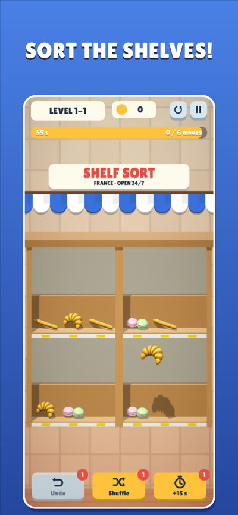
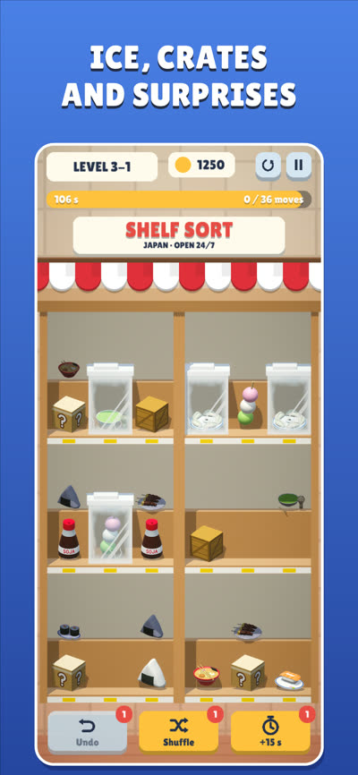
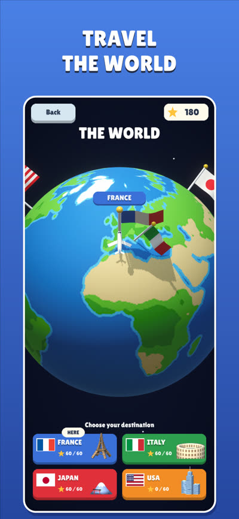
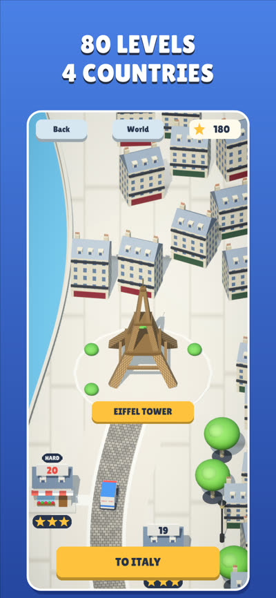
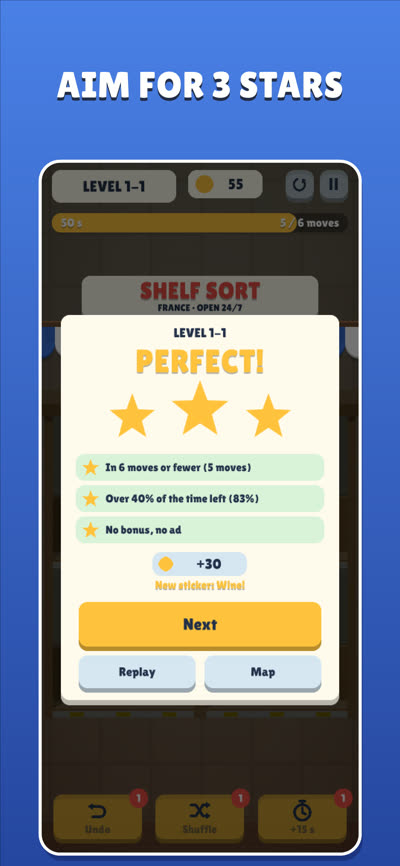

# Shelf Sort: World Tour

A match-3 sorting game for iPhone, made with **Unity 6 (URP)**, coming soon to the App Store.
Drag goods between the shelves, line up 3 identical items to clear them, and empty every aisle before the shop closes,
from a Paris bakery to New York.

  
  
  
  
  

**Preview video and the rest of my games:** [davidbarredo.netlify.app](https://davidbarredo.netlify.app/en.html#shelfsort)

**How it was made:** I designed the game end to end and used AI (Claude) to speed up production: I set the design and
the rules, playtested, spotted what didn't work and iterated until it felt right.

## The game

| | |
|---|---|
| **80 levels, 4 countries** | France, Italy, Japan and the USA, 20 shops each, every one with its own products, 3D map and monument. A 3D globe links them; stars unlock the next country. |
| **Always solvable** | Levels are generated and baked offline: a depth-first solver checks every deal, and rejects the ones only an obscure line solves. |
| **Obstacles and twists** | Frozen goods, mystery cartons, crates, padlocks, golden products, sales and pigeons. None of them can make a level unsolvable. Each new one opens on a bubble with a live 3D demo. |
| **Meta** | 3 stars per level (moves, time left, no bonus), daily challenge with a twist, sticker album per country, chests, bronze/silver/gold trophies, coins that buy Undo, Shuffle and +15 s. |
| **Monetization** | One rewarded ad (AdMob) offered only after a lost level, behind Google's GDPR consent form and Apple's tracking prompt. |
| **Analytics** | GameAnalytics: level start / complete (stars as score) / fail, giving the funnel of where players give up, plus rewarded-ad events. |
| **Languages** | French and English, following the phone's language. Plays offline. |

## Technical choices

- **Products built by code, not modelled** (`Products.cs`, `Food.cs`, `Countries.cs`): bottles and jars are spun from a
  silhouette, boxes and bags are built face by face, then painted with generated textures and labelled with a small
  stroke font (`StrokeFont.cs`). Adding a product is a few lines of data.
- **Level baker** (`Tools/LevelBaker`): a plain .NET console app that compiles the game's own `LevelGen.cs` (with a tiny
  `UnityEngine` shim), bakes 200 levels into `Assets/Resources/levels.txt` and re-checks each one after a round trip
  through the text format. Difficulty keeps climbing from one country to the next.
- **Juice without assets** (`Fx.cs`): synthesized sounds, confetti, tweens and haptics.
- **Shipping pipeline**: iOS builds in Unity Build Automation, with `BuildIOS.PreExport` setting the App Store build
  settings (a build number that always goes up, iPhone only, the export-compliance answer so TestFlight never holds a build) and `ci/upload-testflight.sh` sending the signed `.ipa`
  to TestFlight with an App Store Connect API key.
- **No secrets in the repo**: the GameAnalytics keys are filled from environment variables by `Setup.SetGameAnalyticsKeys`.

## Running the project

1. Open the folder with Unity **6000.5.10f1**.
2. Open `Assets/Scenes/Main.unity` and press Play (portrait resolution in the Game view).
3. To rebake the levels: `cd Tools/LevelBaker && dotnet run`.

3D models from [Kenney](https://kenney.nl) (CC0) and a font under the SIL Open Font License.
Support and privacy policy: [barredodavid.github.io/shelf-sort](https://barredodavid.github.io/shelf-sort/).
